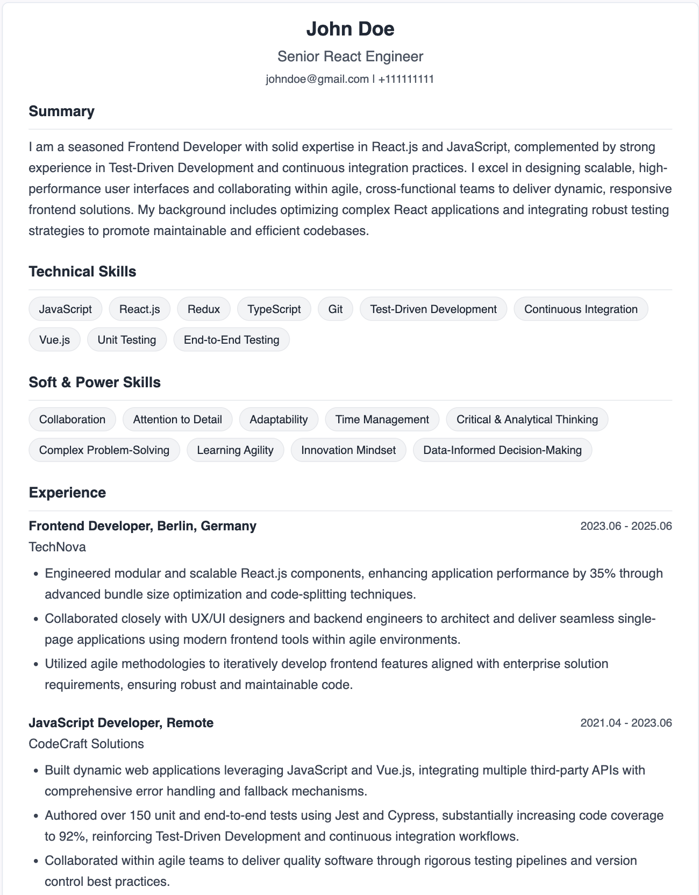

<p align="center">
  <a href="https://quick-cv-eight.vercel.app">
    
  </a>
</p>

# NICE CV

NICE CV rewrites your existing CV for one specific job offer. Paste a job link
or description, upload your CV, and a few tens of seconds later you get a
tailored, ATS-friendly CV in English, Polish or Spanish, ready to download as
a PDF.

**Live:** [quick-cv-eight.vercel.app](https://quick-cv-eight.vercel.app)



## How it works

Generation is split into three model calls, so each one does a single job and
its output can be validated before the next step runs.

```
job offer ──┐
            ├─► 1. extract ──► 2. plan ──► 3. write ──► preview ──► pay ──► PDF
your CV ────┘
```

1. **Extract.** The uploaded PDF is parsed to text, and the model turns it into
   structured data: roles, dates, education, languages, skills.
2. **Plan.** The model compares the CV with the job offer and decides the
   strategy: which skills and ATS keywords to surface, the tone, the focus of
   the summary, and a rewrite instruction for each role.
3. **Write.** The model executes that plan and writes the final CV in the
   target language. Running this step with low reasoning effort keeps it fast,
   because the thinking already happened in step 2.

Every model response is validated with [Zod](https://zod.dev) before it touches
the database. A malformed response fails the request cleanly instead of saving
half a CV.

Job offers can come from a pasted description or a link. Links from
[justjoin.it](https://justjoin.it) and [nofluffjobs.com](https://nofluffjobs.com)
are scraped directly.

Anyone can generate a CV without an account. The preview is partly blurred
until the user signs in and spends a token. Tokens are bought in packs through
Stripe Checkout. The PDF is printed by a remote headless Chromium
([Browserless](https://www.browserless.io)) from the same React template the
preview uses, so what you see is what you download.

## Tech stack

| Area          | Choice                                        |
| ------------- | --------------------------------------------- |
| Framework     | Next.js 15 (App Router), React 19, TypeScript |
| UI            | Tailwind CSS, shadcn/ui, Radix                |
| Data and auth | Supabase (Postgres, Auth, Storage)            |
| AI            | OpenAI Chat Completions with JSON output      |
| Payments      | Stripe Checkout and webhooks                  |
| PDF           | Playwright over CDP to Browserless            |
| Analytics     | PostHog                                       |
| Hosting       | Vercel                                        |
| Quality       | ESLint, Vitest, GitHub Actions                |

## Security notes

- **No direct database access from the browser.** Row Level Security is on
  for every table with no policies for the public roles, so the anon key that
  ships in the bundle can read and write nothing. All data goes through API
  routes that use a server-only key and check ownership themselves.
  `scripts/verify-rls.sh` proves this against a live project.
- **Rate limits where it matters.** Generation works without an account,
  so every endpoint that calls OpenAI or writes data anonymously is limited
  per IP.
- **Idempotent payments.** The Stripe webhook verifies signatures, returns real
  error codes so Stripe retries on failure, and cannot grant the same purchase
  twice.
- **Safe token spending.** A token is charged with conditional updates, so a
  double click or two parallel requests never charge twice.
- **Scoped PDF access.** The headless browser has no session, so it gets a
  two-minute HMAC token that unlocks exactly one CV.
- **No personal data in logs.** Validation errors log field paths, never CV
  content.

## Project structure

```
app/
  api/            route handlers: generation pipeline, Stripe webhook, PDF, data
  create-cv/      the two-step wizard (components and hooks)
  cv-preview/     blurred preview, payment and download
  cv-download/    the page Browserless prints to PDF
lib/
  prompts/        all OpenAI prompts
  cv-schemas.ts   Zod schemas for every model response
  rate-limit.ts   per-IP limiter
  pdf-render-token.ts
locales/          UI translations (en, pl, es)
supabase/         config and migrations
tests/            unit tests
```

## Running locally

Requirements: Node.js 22 or newer, a Supabase project, and API keys for
OpenAI, Stripe and Browserless.

```bash
npm install
cp .env.example .env.local   # then fill in the values
npm run dev
```

To test payments locally, forward Stripe webhooks to the dev server:

```bash
stripe listen --forward-to localhost:3000/api/stripe/webhook
```

## Scripts

| Command             | What it does                                 |
| ------------------- | -------------------------------------------- |
| `npm run dev`       | Start the dev server                         |
| `npm run build`     | Production build                             |
| `npm run lint`      | ESLint                                       |
| `npm run typecheck` | TypeScript without emitting                  |
| `npm test`          | Unit tests with Vitest                       |
| `npm run gen:types` | Regenerate `database.types.ts` from Supabase |

## License

[MIT](LICENSE)
